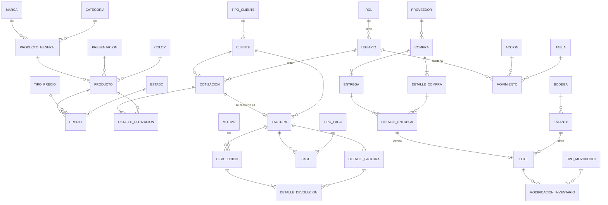

# Sapo Pinturas – Diagnóstico de arquitectura y base de datos

## 1. Base de datos (`PintureriaDB.sql`, SQL Server)

35 tablas en 6 dominios. Todas con PK `IDENTITY`, FKs declaradas y campo `activo` en los catálogos (borrado lógico).



| Dominio | Tablas |
|---|---|
| Seguridad / auditoría | `ROL`, `USUARIO`, `ACCION`, `TABLA`, `MOVIMIENTO` |
| Catálogo de productos | `MARCA`, `CATEGORIA`, `PRESENTACION`, `COLOR`, `PRODUCTO_GENERAL`, `PRODUCTO`, `TIPO_PRECIO`, `PRECIO`, `ESTADO` |
| Clientes y ventas | `TIPO_CLIENTE`, `CLIENTE`, `COTIZACION`, `DETALLE_COTIZACION`, `FACTURA`, `DETALLE_FACTURA`, `TIPO_PAGO`, `PAGO`, `MOTIVO`, `DEVOLUCION`, `DETALLE_DEVOLUCION` |
| Compras | `PROVEEDOR`, `COMPRA`, `DETALLE_COMPRA`, `ENTREGA`, `DETALLE_ENTREGA` |
| Inventario | `BODEGA`, `ESTANTE`, `LOTE`, `TIPO_MOVIMIENTO`, `MODIFICACION_INVENTARIO` |

Ideas clave del modelo:
- **Producto en dos niveles**: `PRODUCTO_GENERAL` (nombre+marca+categoría) → `PRODUCTO` (variante = presentación + color). Único por `(general, presentación, color)`.
- **Precio por tipo** (`TIPO_PRECIO`) con histórico (`fechaAsignacion`, `idEstado`).
- **Flujo de venta**: Cotización → Factura (1:1 opcional) → Pagos (varios medios) → Devoluciones.
- **Flujo de compra**: Compra → Entrega (parciales) → Lote (con estante) → ajustes en `MODIFICACION_INVENTARIO`. El stock real = `LOTE.cantidadDisponible`.
- **Auditoría** genérica con `MOVIMIENTO(usuario, acción, tabla, texto)`.

### Observaciones sobre la BD
1. Los SP `sp_Usuario_ValidarLogin`, `sp_Usuario_Crear`, `sp_Usuario_CambiarContrasena` que usa `usuarios/seguridad.py` **no están en `PintureriaDB.sql`**. Hay que versionarlos.
2. `COTIZACION.descuento` es `DECIMAL(12,2)` (monto) pero `DETALLE_COTIZACION.descuento` y `FACTURA.descuento` son `DECIMAL(5,2)` (¿porcentaje?). Falta definir y unificar.
3. No hay `CHECK` (cantidad > 0, precio ≥ 0, `cantidadDisponible ≤ cantidadInicial`).
4. Totales/subtotales se guardan redundantes: riesgo de inconsistencia (calcular en servicio o con persisted computed columns).
5. `LOTE` no es único por `idDetalleEntrega` aunque conceptualmente es 1:1.
6. `ESTADO` es una sola tabla para todo (precio, compra, factura…): sin distinguir a qué entidad aplica.
7. `PAGO.observaciones` es VARCHAR(100) vs 250 en el resto.
8. Faltan índices en FKs de consulta frecuente (`idCliente`, `idUsuario`, `fecha`).
9. `MOVIMIENTO` no guarda el `id` del registro afectado.

---

## 2. Arquitectura actual (hallazgos)

Estructura: un proyecto Django (`backend/`) + dos apps (`usuarios/`, `app_cotizaciones/`).

| # | Problema | Dónde |
|---|---|---|
| 1 | **Front dentro del back**: la SPA vive en `usuarios/static` + `usuarios/templates`; la app "usuarios" sirve la pantalla de login y TODO el sistema. | `usuarios/static/usuarios/app.js` (2349 líneas), `login.html` |
| 2 | **`app.js` monolítico**: UI, estado, fetch, datos demo (`products`, reportes hardcodeados) y reglas de negocio mezclados; HTML por template strings (riesgo XSS). | `app.js` |
| 3 | **Regla de negocio en el cliente**: la contraseña de autorización de descuentos está en el JS. | `app.js:3` `DISCOUNT_PASSWORD` |
| 4 | **Sin capas**: los ViewSets hacen ORM + reglas + respuesta; `usuarios/` contiene catálogo, clientes, proveedores y seguridad (no es "usuarios"). | `usuarios/models.py`, `views.py` |
| 5 | **Dos mecanismos de auth distintos**: login con `check_password` en la vista, pero `seguridad.py` usa SPs; la sesión es manual (`session["usuario_id"]`) y no el sistema de auth de DRF, por eso `IsAuthenticated` en cotizaciones no corresponde a lo que realmente se valida. | `views.py`, `seguridad.py`, `app_cotizaciones/views.py` |
| 6 | **Endpoints sin permisos**: CRUD de usuarios, roles, precios, clientes… accesibles sin login ni rol. | `usuarios/views.py` |
| 7 | **Secretos en el repo**: `SECRET_KEY`, usuario/clave y host de SQL Server, `DEBUG=True`, `ALLOWED_HOSTS=[]`. | `backend/settings.py` |
| 8 | **Modelos `managed=False`** generados con `inspectdb` (hay un `modelos_mantenimientos.txt` en UTF-16 suelto) y solo ~15 de las 35 tablas están modeladas; compras, inventario, facturas, pagos y devoluciones no existen en código. | `modelos_mantenimientos.txt` |
| 9 | Nombres de campo en minúsculas pegados a la BD (`idproductogeneral`, `contrasenaencriptada`) se filtran a la API. | models/serializers |
| 10 | Sin tests, `requeriments.txt` mal nombrado y en UTF-16, README vacío, `.DS_Store` sin ignorar. | raíz |

---

## 3. Arquitectura propuesta

Principio: **front y back como dos aplicaciones independientes** que solo se hablan por la API REST; y el back en **capas** con dependencia hacia adentro.

```
ProyectoDB/
├── backend/                       # API Django REST (sin HTML)
│   ├── config/                    # settings (base/dev/prod), urls, wsgi
│   ├── apps/
│   │   ├── seguridad/             # usuarios, roles, auth, auditoría
│   │   ├── catalogo/              # marca, categoría, producto, precio…
│   │   ├── clientes/              # clientes, tipos
│   │   ├── ventas/                # cotización, factura, pago, devolución
│   │   ├── compras/               # proveedor, compra, entrega
│   │   └── inventario/            # bodega, estante, lote, movimientos
│   │       ├── models.py          # (dominio/persistencia)
│   │       ├── repositories.py    # consultas ORM / SPs
│   │       ├── services.py        # REGLAS DE NEGOCIO (transacciones)
│   │       ├── serializers.py     # validación entrada/salida
│   │       ├── views.py           # delgado: HTTP ⇄ service
│   │       ├── permissions.py
│   │       └── tests/
│   └── core/                      # utilidades compartidas, excepciones
├── frontend/                      # Solo HTML + CSS (sin frameworks ni build)
│   ├── index.html                 # login
│   ├── pages/                     # una página HTML por módulo
│   │   ├── inicio.html
│   │   ├── catalogo.html
│   │   ├── cotizacion.html
│   │   ├── ventas.html
│   │   ├── compras.html
│   │   ├── mantenimientos.html
│   │   ├── usuarios.html
│   │   └── reportes.html
│   ├── partials/                  # fragmentos reutilizables (header, menú, footer)
│   ├── css/
│   │   ├── base/                  # variables, reset, tipografía
│   │   ├── components/            # botones, tablas, tarjetas, formularios, toast
│   │   └── pages/                 # estilos específicos de cada página
│   ├── assets/                    # imágenes y logos
│   └── js/                        # (solo si hace falta) llamadas a /api, un archivo por recurso
├── database/                      # schema.sql, procedures/, seeds/, migraciones
└── docs/
```

Capas del back (flujo de una petición):

```
View (HTTP) → Serializer (valida) → Service (reglas/transacción)
            → Repository (ORM/SP) → SQL Server
```

Decisiones recomendadas:
- **Front**: únicamente HTML y CSS, segmentado así: una página por módulo, `partials/` para lo repetido y CSS dividido en `base` / `components` / `pages`. Se usan clases con nombres claros (BEM) y variables CSS para colores y espacios. Nota: HTML/CSS solos no pueden consultar la API; para eso queda una capa mínima de JS nativo en `js/` (sin frameworks), o bien que Django renderice las páginas con templates.
- **Auth**: sesión de Django con `django.contrib.auth` real (o JWT) + `permissions` por rol; el descuento autorizado se valida en el servicio de ventas, nunca en el JS.
- **Una sola vía para contraseñas** (hash de Django en el service; eliminar los SP o dejar solo los SP, no ambos).
- **Config por entorno** (`.env` + `django-environ`), rotar la clave ya publicada en git.
- **CORS** (`django-cors-headers`) para dev; en prod, front estático detrás de Nginx y `/api` proxeado.
- **Esquema BD versionado** en `database/` incluyendo los SP.

## 4. Plan de migración sugerido (incremental, sin romper nada)

1. **Fase 0 – Higiene**: `.env`, `.gitignore`, `requirements.txt` UTF-8, rotar credenciales, README.
2. **Fase 1 – Separar front**: mover `static/` y template a `frontend/` y dividirlo en páginas HTML + CSS por módulos, consumiendo `/api`; sin cambiar lógica.
3. **Fase 2 – Reorganizar back por dominios** (`seguridad`, `catalogo`, `clientes`) y añadir `services.py`/`permissions.py`.
4. **Fase 3 – Seguridad**: auth unificada + permisos por rol en todos los endpoints.
5. **Fase 4 – Completar dominios** (ventas, compras, inventario) con sus modelos y servicios; sacar datos demo del front.
6. **Fase 5 – Eliminar `app.js`**: pasar cada pantalla a su página HTML y agregar tests del back.


---

## 5. Estado de la migración

| Fase | Estado |
|---|---|
| 0. Higiene: configuración por variables de entorno, `requirements.txt`, `.env.example` | Hecha |
| 1. Front separado en `frontend/` (HTML, CSS dividido en base, layout y componentes; JS mínimo) | Hecha |
| 2. Back por dominios y capas (`seguridad`, `catalogo`, `clientes`, `compras`, `ventas`, `inventario`, `nucleo`) | Hecha |
| 3. Seguridad: autenticación única, permisos por rol, CSRF, bloqueo de cuenta, política de contraseña, descuento validado en servidor | Hecha |
| 4. Dominios sin modelar: compras y entregas, facturas, pagos, devoluciones, movimientos | Pendiente |
| 5. Reportes y historial (hoy muestran "Disponible próximamente") | Pendiente |

Cambios de comportamiento a tener en cuenta:

- La ruta `/api/cotizaciones/detalles/` antes quedaba tapada por la ruta de detalle de una cotización; ahora responde.
- Antes las cotizaciones solo permitían Administrador, Digitador y Gerente (el rol Administrador no existe y el Cajero quedaba fuera). Ahora pueden Gerente, Digitador y Cajero.
- El catálogo toma las categorías de la API en lugar de una lista fija.
- Se eliminaron las cifras y reportes de demostración del front.
- No se migró el botón "Facturar y convertir en venta": no existe aún el dominio de facturas.
